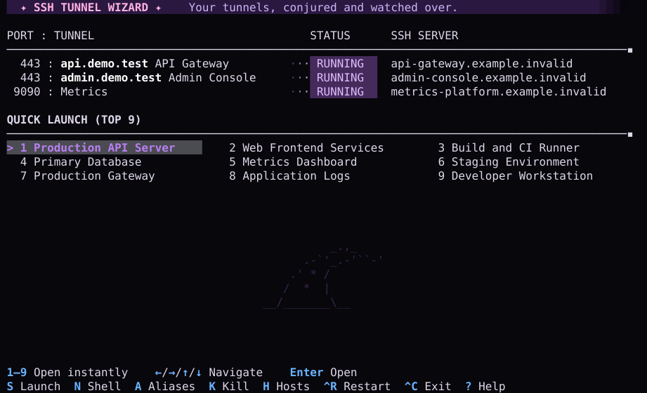

# SSH Tunnel Wizard

**A focused terminal dashboard for your SSH tunnels.** Start and monitor
forwards, launch saved SSH sessions, and open local commands—all from one
lightweight Bash interface.

<p align="center">
  
</p>

<p align="center"><em>96×28 demo from the example config. The status badges are simulated locally; no SSH connection or hosts-file change is made.</em></p>

## What it does

- Starts, stops, and restarts SSH forwards, with live status in a compact dashboard.
- Groups related forwards by machine and gives local hostnames their own loopback addresses—so different services can share a local port.
- Puts nine quick launches on the home screen, with an optional second set of nine and a full keyboard-driven picker.
- Opens saved SSH shells and local Bash commands in separate terminal windows.
- Adds optional Windows hosts-file management and managed Bash aliases.

## Quick start

Requires Bash, OpenSSH, and an interactive terminal. WezTerm is optional.

```bash
cp tunnels.conf.example tunnels.conf
# Edit the example hosts, username, identity path, and forwards first.
bash ./TW.sh
```

The example uses reserved `.invalid` hosts and is not a working connection
profile. TunnelWizard sources its config as Bash code, so only run configs you
trust. To choose a different config or SSH client config:

```bash
bash ./TW.sh /path/to/tunnels.conf --ssh-config ~/.ssh/work.conf
```

## Configuration

```bash
machine ALIAS SSH_HOST SSH_USER IDENTITY_FILE GROUP
tunnel DISPLAY_NAME LOCAL_FORWARD [LOCAL_HOSTNAME]
shell DISPLAY_NAME SSH_TARGET
custom_command DISPLAY_NAME LOCAL_BASH_COMMAND
```

Each tunnel belongs to the most recent machine. A local hostname gives a
forward its own loopback address; **the forward specifies the port**. For
example, use `443:127.0.0.1:443 api.demo.test` to reach a TLS service at
`https://api.demo.test`. Binding ports below 1024 may require elevated
privileges. See [`tunnels.conf.example`](tunnels.conf.example) for a complete
dashboard demo.

## Explore more

The [user guide](docs/user-guide.md) has the full setup and platform details,
including [Windows hostnames](docs/user-guide.md#local-hostnames-and-windows-hosts-file),
[saved-shell launch behavior](docs/user-guide.md#where-saved-shells-and-local-commands-open),
[WezTerm setup](docs/user-guide.md#wezterm-configuration),
[Windows shortcuts](docs/user-guide.md#windows-desktop-shortcut), and
[focused tests](docs/user-guide.md#focused-tests).

For OpenSSH options, see [`ssh_config.example`](ssh_config.example) and the
[OpenSSH configuration reference](https://man.openbsd.org/ssh_config).
